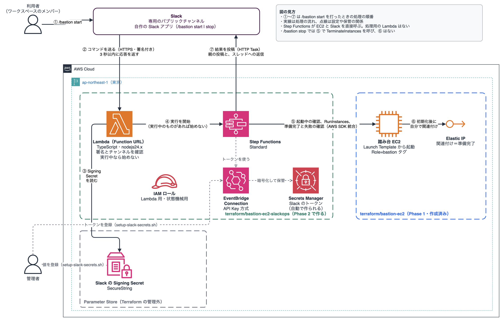

# ephemeral-bastion-ec2

使い捨ての踏み台 EC2 を Terraform で管理するリポジトリです。利用者は Slack のスラッシュコマンド `/bastion start` で踏み台を起動し、手元の DB クライアントから SSH トンネルで AWS 内の DB に接続します。使い終わったら `/bastion stop` で踏み台を Terminate します。

踏み台は毎回新しく作って消すので、OS の更新などの保守が要りません。Elastic IP と SSH のホスト鍵は固定しているので、利用者の接続設定は踏み台が変わってもそのまま使えます。設計の判断と理由は [docs/design.md](docs/design.md) にまとめています。

## アーキテクチャ


```text
terraform/
  bastion-ec2/               # 踏み台の本体（EIP、Security Group、IAM ロール、Launch Template）
  bastion-ec2-slackops/      # Slack から踏み台を起動・終了する仕組み
    lambda/                  # スラッシュコマンドを受ける Lambda（TypeScript）
    templates/               # Step Functions の状態機械の定義
  examples/
    bootstrap/               # state を置く S3 バケット
    sample-db/               # 検証用の RDS for PostgreSQL
scripts/
  setup-ssm-parameters.sh    # SSH のホスト鍵と利用者の公開鍵を SSM に置く
  setup-slack-secrets.sh     # Slack の Signing Secret と Bot トークンを登録する
docs/
  design.md                  # 設計の判断と理由
```

Terraform は独立して apply する 4 つの構成に分けています。構成どうしは state を参照しません。

| 構成 | 主なリソース | 役割 |
|---|---|---|
| `bastion-ec2` | EIP、Security Group、IAM ロール、Launch Template、CloudWatch Logs | 踏み台の本体。踏み台は Launch Template から起動し、初期化が終わると自分で EIP を付ける |
| `bastion-ec2-slackops` | Lambda（Function URL）、Step Functions、EventBridge の接続、IAM ロール | Slack のスラッシュコマンドで、踏み台を起動・終了する。`bastion-ec2` のリソースは、名前とタグで引く |
| `examples/sample-db`（任意） | RDS for PostgreSQL、DB Subnet Group、Security Group | DB を持たない人が試すための DB |
| `examples/bootstrap`（任意） | S3 バケット | state の保存先 |

リージョンは `ap-northeast-1` に固定しています。リソース名の接頭辞は変数 `resource_prefix`（既定値は `ephemeral-bastion`）で変えられます。変えるときは、すべての構成で同じ値にし、スクリプトでは環境変数 `RESOURCE_PREFIX` で同じ値を指定してください。

### Slack から起動するときの流れ



Lambda は Slack の署名と、専用チャンネルからのコマンドかを確かめ、Step Functions の実行を始めます。EC2 の起動・終了と Slack への投稿は、Step Functions が直接行います。公開される Lambda には EC2 を操作する権限を持たせていません。

## 仕組みのデプロイ

### 前提

- AWS 上に、次のものがあること
  - VPC と、踏み台を置くパブリックサブネット
  - 接続先の DB。なければ `sample-db` で作れる。その場合は、異なる AZ のプライベートサブネットが 2 つ以上要る
- 次のものが手元に入っていること
  - [AWS CLI](https://docs.aws.amazon.com/ja_jp/cli/latest/userguide/getting-started-install.html)
  - [mise](https://mise.jdx.dev/)。Terraform、Node.js、pnpm のバージョンを `mise.toml` で固定している
- Slack のワークスペースで、アプリを作れること
- （任意）AI エージェントで作業する場合は、[Agent Toolkit for AWS](https://docs.aws.amazon.com/agent-toolkit/latest/userguide/what-is-agent-toolkit.html) の導入を勧める

リポジトリの直下で、ツールを入れます。

```bash
mise install
```

AWS の認証情報は環境変数かプロファイルで設定しておきます。以下のコマンドは、どれもその認証情報で実行します。

### 1. state の保存先を用意する

state は S3 バケット `tfstate-<アカウント ID>` に、構成ごとのキーで置きます。バケットは `terraform/examples/bootstrap` で作ります。

各構成では `backend.hcl.example` を `backend.hcl` にコピーし、`<アカウント ID>` を書き換えてから初期化します。`backend.hcl` は `.gitignore` に入っているので、アカウント ID はリポジトリに残りません。

```bash
terraform init -backend-config=backend.hcl
```

### 2. 接続先の DB を用意する

手持ちの DB を使うなら、その DB のホスト名、ポート、Security Group の ID を控えます。

DB がなければ、`sample-db` で検証用の RDS を作ります。`terraform.tfvars.example` を `terraform.tfvars` にコピーして、VPC とプライベートサブネットの ID を書きます。マスターパスワードは write-only の引数で渡すので、state には残りません。シェルの履歴にも残らないよう、画面に表示せずに環境変数へ読み込んでから apply します。

```bash
cd terraform/examples/sample-db
read -rs TF_VAR_db_password && export TF_VAR_db_password
terraform init -backend-config=backend.hcl
terraform apply
```

出力の `db_host`、`db_port`、`db_security_group_id` を、`bastion-ec2` の変数に使います。

### 3. SSH の鍵を SSM に置く

利用者の公開鍵のファイルを渡して、スクリプトを実行します。SSH のホスト鍵がなければ生成して置き、利用者の公開鍵は上書きで置きます。利用者を足したり外したりするときも、同じスクリプトを実行し直します。Terraform を apply し直す必要はありません。

```bash
scripts/setup-ssm-parameters.sh alice.pub bob.pub
```

### 4. bastion-ec2 を作る

`terraform/bastion-ec2/terraform.tfvars.example` を `terraform.tfvars` にコピーして、値を書き換えます。`allowed_cidrs` には、SSH を許可する接続元の IP を書きます。個人の IP が入るので、`terraform.tfvars` は `.gitignore` に入れてあります。

```bash
cd terraform/bastion-ec2
terraform init -backend-config=backend.hcl
terraform plan
terraform apply
```

出力の `eip_public_ip` が利用者の接続先になります。

### 5. Slack の専用チャンネルを用意する

踏み台を操作する専用のパブリックチャンネルを作ります。チャンネル名を押して開く「チャンネル詳細」の一番下にある、チャンネル ID（`C` から始まる値）を控えます。ほかのチャンネルで打った `/bastion` には反応しません。

### 6. bastion-ec2-slackops を作る

Terraform はビルドをしないので、先に Lambda を JavaScript の 1 ファイルにビルドします。ビルド、テスト、Lint、フォーマットは Vite+ で行います。

```bash
cd terraform/bastion-ec2-slackops/lambda
pnpm install
pnpm run check
pnpm run typecheck
pnpm test
pnpm run build
```

`dist/index.mjs` ができます。`terraform.tfvars.example` を `terraform.tfvars` にコピーし、`slack_channel_id` に、手順 5 で控えたチャンネル ID を書いてから apply します。

```bash
cd terraform/bastion-ec2-slackops
terraform init -backend-config=backend.hcl
terraform plan
terraform apply
```

出力の `function_url` を、次の手順で Slack アプリに設定します。

```bash
terraform output -raw function_url
```

### 7. Slack アプリを作る

[Slack の API サイト](https://api.slack.com/apps)で「Create New App」を押し、「Paste a manifest」を選びます。ワークスペースを選んでから、YAML の形式で次を貼り付けます。`<function_url>` は、手順 6 で表示した URL に置き換えてください。

```yaml
display_information:
  name: bastion
features:
  bot_user:
    display_name: bastion
    always_online: false
  slash_commands:
    - command: /bastion
      url: <function_url>
      description: 踏み台を起動・終了する
      usage_hint: start | stop
      should_escape: false
oauth_config:
  scopes:
    bot:
      - commands
      - chat:write
settings:
  org_deploy_enabled: false
  socket_mode_enabled: false
  token_rotation_enabled: false
```

アプリを作ったら、次の 2 つを行います。

1. 左のメニューの「Install App」で、ワークスペースにインストールする
2. 専用チャンネルで `/invite @bastion` を打って、アプリを招待する。招待していないチャンネルには投稿できない

### 8. Slack の秘密情報を登録する

スクリプトを実行し、2 つの値を貼り付けます。入力した値は画面に表示されず、シェルの履歴にも残りません。

- Signing Secret: 「Basic Information」の「App Credentials」にある値
- Bot トークン: 「Install App」に表示される「Bot User OAuth Token」（`xoxb-` から始まる値）

```bash
scripts/setup-slack-secrets.sh
```

空のまま Enter を押した項目は変わらないので、片方だけを登録し直すこともできます。Bot トークンは、Terraform がダミーの値で作った EventBridge の接続に登録します。Terraform はこの値の変更を無視するので、apply し直しても、本物のトークンは上書きされません。

## 使い方

### 踏み台を起動・終了する

専用チャンネルで `/bastion start` を打ちます。チャンネルに受け付けの投稿が 1 件だけ出て、経過と結果はそのスレッドに入ります。

```text
/bastion start を受け付けました
• 実行した人: @user
  └ 踏み台サーバーを起動しています
    • サーバー ID: i-0123456789abcdef0
    準備ができるまで 1〜2 分かかります。
  └ 準備ができました
    接続できます。
```

使い終わったら `/bastion stop` を打ちます。スレッドに「踏み台サーバーを終了しています」と「終了しました」が入ります。すでに起動している、起動中の踏み台がない、のような場面では、その旨をスレッドに返して終わります。

管理者は AWS CLI でも起動・終了できます。起動は `bastion-ec2` の出力の `launch_template_id` を指定して、`run-instances` を 1 回実行します。

```bash
aws ec2 run-instances --region ap-northeast-1 --launch-template LaunchTemplateId=<launch_template_id>
```

終了は `Role=bastion` タグの踏み台を探して、Terminate します。

```bash
aws ec2 describe-instances --region ap-northeast-1 \
  --filters Name=tag:Role,Values=bastion Name=instance-state-name,Values=pending,running \
  --query 'Reservations[].Instances[].InstanceId' --output text
```

```bash
aws ec2 terminate-instances --region ap-northeast-1 --instance-ids <インスタンス ID>
```

### DB に接続する

利用者はユーザー `tunnel` と自分の秘密鍵で、踏み台の EIP にポート `2222`（変数 `ssh_port`）で接続し、DB へのポートフォワードだけを使います。シェルには入れません。DB クライアントの SSH トンネルの設定にも、次の ssh コマンドと同じ値を入れます。

```bash
ssh -N -L 15432:<db_host>:5432 -p 2222 -i <秘密鍵> tunnel@<eip_public_ip>
```

この例では DB クライアントから `localhost:15432` に接続します。`-L` の指定で、手元の 15432 番への接続が SSH の接続の中を通って踏み台まで運ばれ、踏み台から DB の 5432 番に届きます。DB はプライベートサブネットにあり、踏み台からの接続だけを受け付けるので、手元から直接はつなげません。手元の番号は、空いていれば何番でも構いません。

転送先は `bastion-ec2` の変数 `db_host` と同じ名前にしてください。sshd は転送先を文字列のまま比べるので、IP アドレスや別名では拒否されます。

### DB に接続できるかを確かめる

psql で、トンネルを通って DB にログインできるかを確かめます。psql は Homebrew の libpq に入っています。

```bash
brew install libpq
```

ターミナルを 2 つ使います。1 つ目のターミナルで、前の節の ssh コマンドを実行してトンネルを張ります。何も表示されずに止まったままになれば、トンネルが張れています。

2 つ目のターミナルで、psql からログインします。パスワードを聞かれたら、DB のパスワード（`sample-db` なら、作ったときのマスターパスワード）を入力します。

```bash
$(brew --prefix libpq)/bin/psql -h localhost -p 15432 -U postgres -d postgres -c 'select version();'
```

`PostgreSQL 18.6 on ...` のような行が返れば、踏み台を通って DB にログインできています。確かめ終わったら、1 つ目のターミナルを `Ctrl+C` で止めます。

つながらないときは、エラーの文で原因を絞れます。

| エラー | 考えられる原因 |
|---|---|
| ssh で `Connection timed out` | 手元の IP が、`allowed_cidrs` に入っていない |
| ssh で `Connection refused` | 踏み台がまだ準備中か、すでに終了している |
| ssh で `Permission denied (publickey)` | 秘密鍵が、登録した公開鍵と対になっていない |
| psql がつながらず、1 つ目のターミナルに `open failed: administratively prohibited` | ssh の転送先が `db_host` の名前と一致せず、踏み台が転送を拒否した |
| psql で `password authentication failed` | DB のユーザー名かパスワードが違う |

## 後片付け

踏み台が起動していれば、先に `/bastion stop` で終了しておきます。そのあと、作った順の逆で destroy します。`bastion-ec2-slackops` は `bastion-ec2` のリソースを名前で引くので、先に消します。

```bash
cd terraform/bastion-ec2-slackops
terraform destroy
```

```bash
cd terraform/bastion-ec2
terraform destroy
```

`sample-db` を作った場合は、最後に消します。

```bash
cd terraform/examples/sample-db
terraform destroy
```

Terraform の外で作った SSM パラメータは、destroy では消えません。要らなくなったら、`/<resource_prefix>/host-key`、`/<resource_prefix>/user-public-keys`、`/<resource_prefix>/slack-signing-secret` を消してください。Slack アプリも Slack の API サイトから削除します。

## 補足

### うまく動かないとき

- スレッドに「起動できませんでした」「終了できませんでした」と出たら、Step Functions のコンソールで、`bastion-ec2-slackops` の出力の `state_machine_arn` の状態機械を開く。失敗した実行には、止まった状態の名前とエラーの内容が残る
- コマンドを打っても何も起きないときは、Lambda のログ（CloudWatch Logs の `/aws/lambda/<resource_prefix>-slack-command`）を見る。署名の確認に失敗した理由などが残る
- 踏み台の初期化に失敗したときは、`bastion-ec2` の出力の `log_group_name` のロググループを見る。User Data の実行ログと sshd のログが、インスタンス ID ごとに残る

### Lambda のコードを変えたとき

ビルドしてから plan と apply をします。ビルドを忘れると、古いコードのまま plan されます。フォーマットと Lint の指摘は、`pnpm run fix` で直せるものは直せます。

```bash
cd terraform/bastion-ec2-slackops/lambda
pnpm run check
pnpm run typecheck
pnpm test
pnpm run build
cd ..
terraform plan
terraform apply
```

### Powertools のバージョンを上げるとき

Powertools for AWS Lambda は、AWS が公開している Lambda レイヤーで読み込みます。バージョンを上げるときは、`main.tf` の `powertools_layer_arn` のレイヤーの番号と、`lambda/package.json` の `@aws-lambda-powertools/*` のバージョンを一緒に上げます。

### Claude Code から AWS を操作するとき

Claude Code は Agent Toolkit for AWS の `aws-core` プラグインに同梱の AWS MCP を通して AWS を操作します。同梱の AWS MCP は `default` プロファイルの認証情報で動きます。

同梱の AWS MCP のエンドポイントは us-east-1 にあり、`default` プロファイルのリージョンを、リクエストの署名に使います。`default` のリージョンを `us-east-1` 以外にすると、リクエストが 401 で拒否されます。操作するリソースのリージョンは呼び出しごとに指定するので、`default` のリージョンとは関係ありません。

`default` が IAM Identity Center（SSO）のプロファイルなら、トークンの期限が切れると AWS を操作できなくなります。`aws sso login` でログインし直してから、Claude Code の `/mcp` で AWS MCP を再接続してください。
