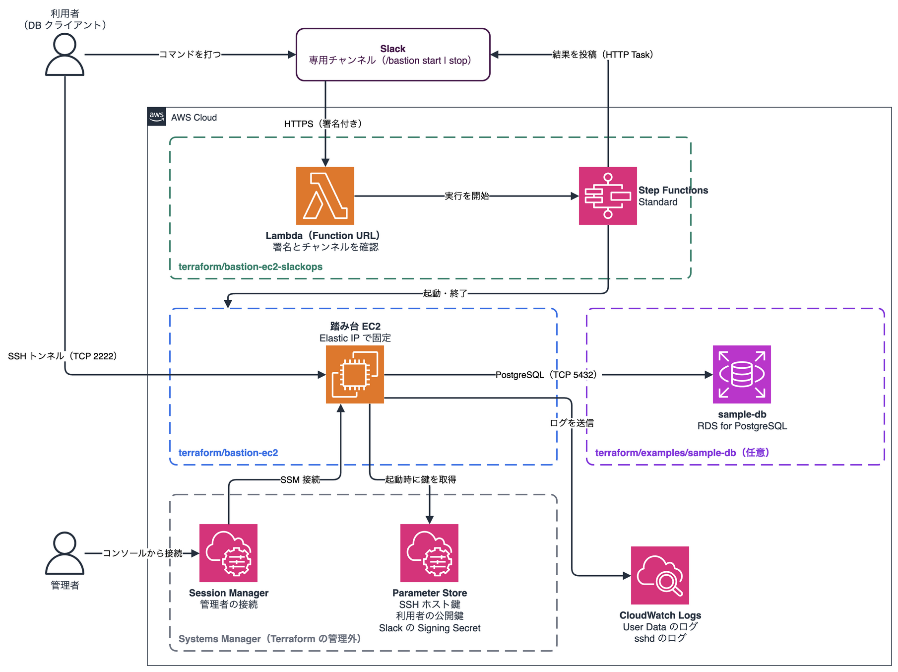

# ephemeral-bastion-ec2

下記の Zenn で紹介しているサンプルです。Slack のスラッシュコマンドで踏み台 EC2 を起動し、SSH トンネルで AWS 内の DB に接続する仕組みです。踏み台は使うたびに新しく作り、使い終わったら Terminate します。

- https://zenn.dev/babyjob/articles/ephemeral-bastion-ec2

## アーキテクチャ



```text
terraform/
  bastion-ec2/               # 踏み台の本体（EIP、Security Group、IAM ロール、Launch Template）
  bastion-ec2-slackops/      # Slack から踏み台を起動・終了する仕組み
    lambda/                  # スラッシュコマンドを受ける Lambda（TypeScript）
    templates/               # Step Functions の状態機械の定義
  examples/
    bootstrap/               # state を置く S3 バケット
    sample-db/               # 検証用の RDS for PostgreSQL
scripts/
  setup-ssm-parameters.sh    # SSH のホスト鍵と利用者の公開鍵を SSM に置く
  setup-slack-secrets.sh     # Slack の Signing Secret と Bot トークンを登録する
docs/
  design.md                  # 設計の判断と理由
```

Terraform は 4 つの構成に分けています。構成どうしは state を参照しません。

| 構成 | 主なリソース | 役割 |
|---|---|---|
| `bastion-ec2` | EIP、Security Group、IAM ロール、Launch Template | 踏み台の本体 |
| `bastion-ec2-slackops` | Lambda（Function URL）、Step Functions、EventBridge Connection | Slack から踏み台を起動・終了する |
| `examples/sample-db`（任意） | RDS for PostgreSQL | 検証用の DB |
| `examples/bootstrap`（任意） | S3 バケット | state の保存先 |

### Slack から起動するときの流れ


Lambda は Slack の署名とチャンネルを確かめて、Step Functions の実行を始めます。EC2 の操作と Slack への投稿は Step Functions が行います。

## 仕組みのデプロイ

### 前提

- AWS 上に次のものがあること
  - VPC とパブリックサブネット
  - 接続先の DB。`sample-db` で作る場合は、異なる AZ のプライベートサブネットが 2 つ以上要る
- 次のものがインストールされていること
  - [AWS CLI](https://docs.aws.amazon.com/ja_jp/cli/latest/userguide/getting-started-install.html)
  - [mise](https://mise.jdx.dev/)（Terraform、Node.js、pnpm を入れる）
- Slack のワークスペースでアプリを作れること
- （任意）AI エージェントで作業する場合は [Agent Toolkit for AWS](https://docs.aws.amazon.com/agent-toolkit/latest/userguide/what-is-agent-toolkit.html) の導入を推奨

### 準備

コマンドはリポジトリの直下で、AWS の認証情報を設定したシェルから実行します。

```bash
mise install
```

デプロイする構成ごとに、`backend.hcl.example` を `backend.hcl` に、`terraform.tfvars.example` を `terraform.tfvars` にコピーし、値を書き換えます。どちらのコピーも Git の管理外です。state は S3 バケット `tfstate-<アカウント ID>` に保存します。バケットがなければ `examples/bootstrap` で作ります。最初はローカル state で apply し、バケットができたら state をそこへ移します。

リージョンは `ap-northeast-1` に固定しています。リソース名の接頭辞を変えるときは、全構成の変数 `resource_prefix` と、スクリプトの環境変数 `RESOURCE_PREFIX` を同じ値にします。

### 1. DB（任意）

検証用の DB が要る場合だけデプロイします。`read` の行では、DB のマスターパスワードを入力します。

```bash
read -rs TF_VAR_db_password && export TF_VAR_db_password
terraform -chdir=terraform/examples/sample-db init -backend-config=backend.hcl
terraform -chdir=terraform/examples/sample-db apply
```

出力の `db_host`、`db_port`、`db_security_group_id` を `bastion-ec2` の変数に使います。

### 2. 踏み台

利用者の公開鍵を登録します。SSH のホスト鍵も、なければ作られます。

```bash
scripts/setup-ssm-parameters.sh alice.pub bob.pub
```

`bastion-ec2` をデプロイします。`allowed_cidrs` には SSH を許可する接続元の IP を書きます。

```bash
terraform -chdir=terraform/bastion-ec2 init -backend-config=backend.hcl
terraform -chdir=terraform/bastion-ec2 apply
```

出力の `eip_public_ip` が、利用者の SSH の接続先です。

### 3. Slack から操作する仕組み

Slack に専用のパブリックチャンネルを作り、「チャンネル詳細」の一番下にあるチャンネル ID を `slack_channel_id` に書きます。

Lambda をビルドしてから `bastion-ec2-slackops` をデプロイします。

```bash
cd terraform/bastion-ec2-slackops/lambda
pnpm install
pnpm run build
cd -

terraform -chdir=terraform/bastion-ec2-slackops init -backend-config=backend.hcl
terraform -chdir=terraform/bastion-ec2-slackops apply
terraform -chdir=terraform/bastion-ec2-slackops output -raw function_url
```

### 4. Slack アプリ

[Slack の API サイト](https://api.slack.com/apps)の「Create New App」→「Paste a manifest」で、次の YAML からアプリを作ります。`<function_url>` は手順 3 の最後に表示された URL に置き換えます。

```yaml
display_information:
  name: bastion
features:
  bot_user:
    display_name: bastion
    always_online: false
  slash_commands:
    - command: /bastion
      url: <function_url>
      description: 踏み台を起動・終了する
      usage_hint: start | stop
      should_escape: false
oauth_config:
  scopes:
    bot:
      - commands
      - chat:write
settings:
  org_deploy_enabled: false
  socket_mode_enabled: false
  token_rotation_enabled: false
```

「Install App」でワークスペースにインストールし、専用チャンネルで `/invite @bastion` を実行します。

最後に、Slack の秘密情報を登録します。

```bash
scripts/setup-slack-secrets.sh
```

| 入力する値 | Slack アプリの設定画面での場所 |
|---|---|
| Signing Secret | 「Basic Information」の「App Credentials」 |
| Bot トークン（`xoxb-` から始まる値） | 「Install App」の「Bot User OAuth Token」 |

## 使い方

### 起動・終了

専用チャンネルで `/bastion start` を実行します。1〜2 分で準備が終わり、経過と結果はスレッドに投稿されます。

```text
/bastion start を受け付けました
• 実行した人: @user
  └ 踏み台サーバーを起動しています
    • サーバー ID: i-0123456789abcdef0
    準備ができるまで 1〜2 分かかります。
  └ 準備ができました
    接続できます。
```

使い終わったら `/bastion stop` を実行します。

### DB への接続

SSH トンネルを張り、DB クライアントから `localhost:15432` に接続します。

```bash
ssh -N -L 15432:<db_host>:5432 -p 2222 -i <秘密鍵> tunnel@<eip_public_ip>
```

- `<db_host>` は `bastion-ec2` の変数 `db_host` と同じ文字列にする。IP アドレスや別名では拒否される
- トンネルが張れると、何も表示されずに待機する。`Ctrl+C` で切断する

psql（`brew install libpq`）で確かめる場合は、別のターミナルで次を実行します。

```bash
$(brew --prefix libpq)/bin/psql -h localhost -p 15432 -U postgres -d postgres -c 'select version();'
```

`PostgreSQL 18.6 on ...` のような行が返れば成功です。

## 後片付け

`/bastion stop` で踏み台を終了してから、作った順の逆で削除します。

```bash
terraform -chdir=terraform/bastion-ec2-slackops destroy
terraform -chdir=terraform/bastion-ec2 destroy
terraform -chdir=terraform/examples/sample-db destroy   # 作った場合だけ
```

次のものは Terraform の外で作ったので、手動で削除します。

- SSM パラメータ `/<resource_prefix>/host-key`、`/<resource_prefix>/user-public-keys`、`/<resource_prefix>/slack-signing-secret`
- Slack アプリ

## 補足

### 接続できないとき

| エラー | 考えられる原因 |
|---|---|
| ssh で `Connection timed out` | 手元の IP が、`allowed_cidrs` に入っていない |
| ssh で `Connection refused` | 踏み台がまだ準備中か、すでに終了している |
| ssh で `Permission denied (publickey)` | 秘密鍵が、登録した公開鍵と対になっていない |
| psql がつながらず、SSH トンネルのターミナルに `open failed: administratively prohibited` | ssh の転送先が `db_host` の名前と一致せず、踏み台が転送を拒否した |
| psql で `password authentication failed` | DB のユーザー名かパスワードが違う |

### 起動・終了に失敗したとき

| 症状 | 確認するもの |
|---|---|
| コマンドを実行しても何も起きない | CloudWatch Logs の `/aws/lambda/<resource_prefix>-slack-command` |
| スレッドに「起動できませんでした」「終了できませんでした」と出た | Step Functions の実行履歴（出力 `state_machine_arn`） |
| 踏み台の初期化に失敗した | `bastion-ec2` の出力 `log_group_name` のロググループ |

### 設定やコードを変えるとき

- 利用者の追加・削除: `scripts/setup-ssm-parameters.sh` に全員の公開鍵を渡して実行し直す。公開鍵は上書きされる。apply は不要
- Slack の秘密情報の更新: `scripts/setup-slack-secrets.sh` を実行し直す。空のまま Enter を押した項目は変わらない
- Lambda のコード: `pnpm run check`、`pnpm run typecheck`、`pnpm test` で確かめ、手順 3 のビルドと apply をやり直す
- Powertools のバージョン: `main.tf` の `powertools_layer_arn` と、`lambda/package.json` の `@aws-lambda-powertools/*` を一緒に上げる

### Slack を使わずに起動・終了する

管理者は AWS CLI でも操作できます。

```bash
# 起動（ID は bastion-ec2 の出力 launch_template_id）
aws ec2 run-instances --region ap-northeast-1 --launch-template LaunchTemplateId=<launch_template_id>

# 終了（1 つ目のコマンドで ID を調べる）
aws ec2 describe-instances --region ap-northeast-1 \
  --filters Name=tag:Role,Values=bastion Name=instance-state-name,Values=pending,running \
  --query 'Reservations[].Instances[].InstanceId' --output text
aws ec2 terminate-instances --region ap-northeast-1 --instance-ids <インスタンス ID>
```

### Claude Code から AWS を操作するとき

Agent Toolkit for AWS の `aws-core` プラグインに同梱の AWS MCP は、`default` プロファイルの認証情報で動きます。

- `default` のリージョンは `us-east-1` にする。署名に使われ、ほかの値では 401 で拒否される。操作するリソースのリージョンとは関係ない
- SSO のトークンが切れたら、`aws sso login` のあと `/mcp` で再接続する
